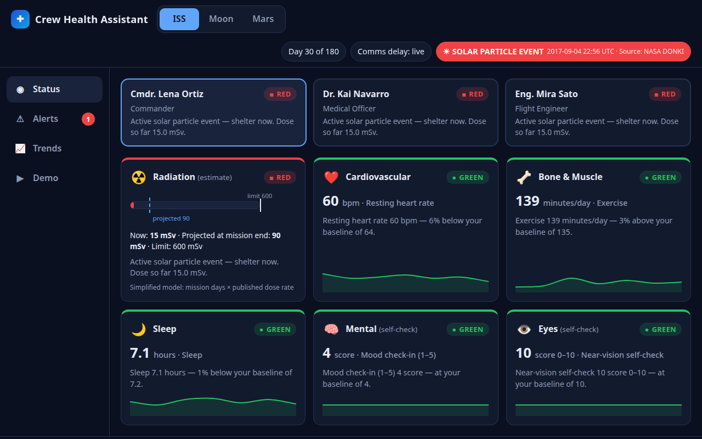
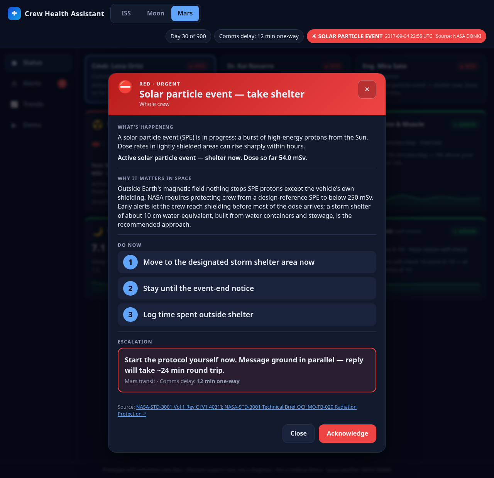
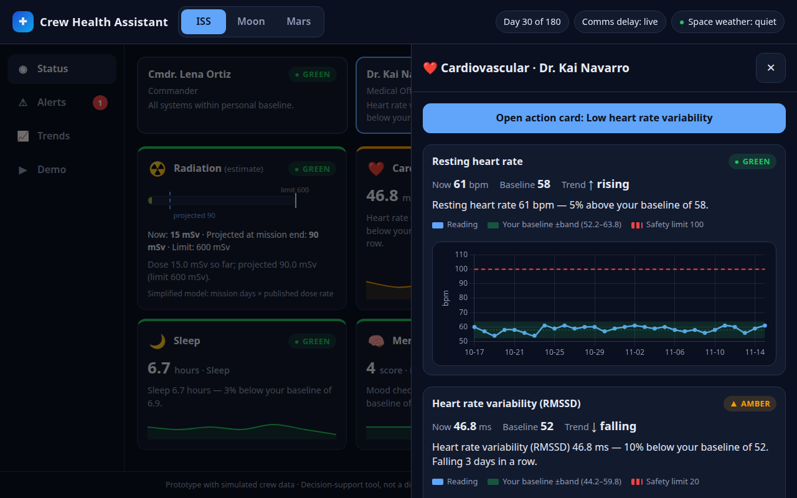
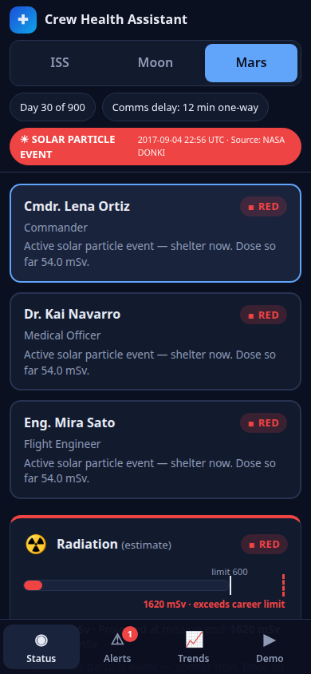

# Onboard Crew Health Assistant

NASA Space Apps Challenge 2026 prototype. An onboard health assistant for astronauts that compares each crew member
against their **own** pre-flight baseline, shows a GREEN / AMBER / RED status per body system, and turns every problem
into a concrete, rule-based action card. Escalation wording adapts to the mission context (ISS, lunar surface, Mars
transit), because "call the flight surgeon" means something very different with a 24-minute round-trip delay.
A whole-crew radiation module combines published dose rates with a replayed NASA DONKI solar particle event.
There is no LLM anywhere: every status and recommendation comes from transparent rules and thresholds kept in JSON data files.

> **Disclaimer:** Prototype with simulated crew data. Decision-support tool, not a diagnosis. Not a medical device.



▶ **[30-second captioned demo video](docs/demo/crew-health-demo.mp4)** (solar storm → action card → switch to Mars)

| Action card after switching to Mars | Module panel with 30-day trend | Phone |
|---|---|---|
|  |  |  |

## Run

Requires Java 21+.

```bash
./mvnw spring-boot:run          # http://localhost:8080 (override with PORT=xxxx)
./mvnw test                     # unit + API flow tests
./demo.sh                       # curl walkthrough of the demo (needs the app running; jq optional)
```

Docker:

```bash
docker build -t crew-health .
docker run -p 8080:8080 -e PORT=8080 crew-health
```

## Deploy

[](https://render.com/deploy?repo=https://github.com/Talant2801/nasa-crew-health-assistant)

The repo includes a Render Blueprint (`render.yaml`): free Docker web service, health check on `/api/health`,
auto-deploy on push to `main`. Render injects `PORT`; the Dockerfile passes it to Spring Boot.
The free tier sleeps after ~15 min idle, so the first request can take up to a minute — the frontend shows a
"Backend waking up" banner and retries automatically. Open the app a minute before demoing.

Any Docker host works the same way (Railway, Fly.io, etc.): build the Dockerfile and set `PORT`.

## Using the app

Open http://localhost:8080 (or the deployed URL).

- **Mission header** (always visible): switch ISS / Moon / Mars; shows mission day, comms delay and space weather.
- **Status**: one card per astronaut, then one tile per body system for the selected astronaut —
  Radiation (estimate), Cardiovascular, Bone & Muscle, Sleep, Mental (self-check), Eyes (self-check).
  Click a tile for the 30-day chart with the personal baseline band and safety limit.
- **Action card**: what is happening, why it matters in space, numbered "Do now" steps, mission-specific
  escalation and the cited NASA source. Switch the mission while a card is open and the escalation updates live.
- **Alerts**: everything AMBER/RED for the selected astronaut plus crew-wide alerts, RED first.
- **Trends**: any astronaut × indicator, 30 days.
- **Demo**: one-click scenarios for judges — solar storm, sleep deficit, reset.

Suggested demo (≈60 s): Status (all green, Navarro's HRV drifting) → Demo → *Solar storm* → click the red
Radiation tile → with the card open, switch to *Mars* and watch the escalation change to "start the protocol yourself".

The frontend is plain HTML/CSS/ES modules in `src/main/resources/static/` (no build step); Chart.js is the only library.
Screenshots and the demo video are generated from the running app by `tools/screenshots.mjs` and `tools/record-demo.mjs`
(headless Chrome; see the header comment of each script).

## How it works

| Rule | Logic |
|---|---|
| Indicator RED | latest value breaches the absolute limit (`absoluteLimit` / `limitDirection`) |
| Indicator AMBER | latest value outside personal baseline ± `bandPercent`, **or** the last 3 day-over-day changes all go in `badDirection` |
| Module / overall status | worst indicator in the body system / worst module (incl. RADIATION) |
| Radiation | RED if a solar particle event is active (→ `spe-shelter`); RED if current dose ≥ 600 mSv; AMBER if projected mission dose ≥ 600 mSv (→ `dose-projection`) |
| Radiation model | Simplified: mission days × published dose rate for the environment |
| Escalation text | mission-specific text when severity is RED or the card is `URGENT`, otherwise "Monitor and re-measure tomorrow." |

Thresholds, cards and mission profiles live in `src/main/resources/data/`:
`indicators.json`, `action-cards.json`, `missions.json`, `donki-sep.json`.
Seed data (3 fictional astronauts, 30 days of readings) is regenerated at startup with fixed random seed 42.
All state is in memory; `POST /api/scenarios/reset` restores the defaults.

## API

All endpoints are under `/api`, JSON, camelCase. CORS is open on `/api/**`.

| Method | Path | Description |
|---|---|---|
| GET | `/api/health` | `{ "status": "UP" }` |
| GET | `/api/mission` | Mission context: env, label, missionDay, missionLengthDays, commsDelaySeconds, escalation, doseRateMSvPerDay, doseSource, spaceWeather |
| POST | `/api/mission/context` | Body `{ "env": "ISS" \| "MOON" \| "MARS" }` → same as GET (missionDay kept) |
| GET | `/api/crew` | `[ { id, name, role, overallStatus, topIssue } ]` |
| GET | `/api/crew/{id}/modules` | Body-system modules with indicators (value, baseline, status, trend, summary, last7) + crew-wide RADIATION module |
| GET | `/api/crew/{id}/readings?indicator=HR_REST&days=30` | `{ indicator, unit, baseline, bandLow, bandHigh, absoluteLimit, series }` |
| GET | `/api/alerts?crewId={id}` | Derived alerts (RED first), each with full action card and escalation text. `crewId` optional; crew-wide alerts always included |
| POST | `/api/alerts/{id}/ack` | Acknowledge alert (ids like `navarro:HRV`, `crew:RADIATION`) → 204 |
| POST | `/api/scenarios/{name}` | `solar-storm`, `sleep-deficit`, `reset` → 204; unknown → 404 |

Crew ids: `ortiz`, `navarro`, `sato`. Unknown astronaut / indicator / scenario → 404 with `{ status, error, message }`.

## Data & Licenses

**Data sources**

- **NASA DONKI** (Space Weather Database Of Notifications, Knowledge, Information), SEP endpoint, via api.nasa.gov — US Government work, public domain.
  `data/donki-sep.json` is a cached response of
  `GET https://api.nasa.gov/DONKI/SEP?startDate=2017-09-01&endDate=2017-09-30` (September 2017 events).
  The app replays the first event; it **never** calls the live API at runtime.
- **[NASA-STD-3001 Volume 1, Rev C](https://standards.nasa.gov/sites/default/files/standards/NASA/C//nasa-std-3001-vol-1-rev-c-signature.pdf)**
  (NASA Spaceflight Human-System Standard, 2023) — career effective dose < 600 mSv [V1 4030];
  protection from the design-reference solar particle event to < 250 mSv [V1 4031]; ALARA [V1 4029].
- **Dose rates** (`data/missions.json`):
  - ISS: ~0.2–0.5 mSv/day — [Space agency-specific standards for crew dose… ISS, *Z Med Phys* 2024 (PMC10919966)](https://pmc.ncbi.nlm.nih.gov/articles/PMC10919966/)
  - Lunar surface: 1369 µSv/day — [Zhang et al. 2020, "First measurements of the radiation dose on the lunar surface", *Science Advances*](https://doi.org/10.1126/sciadv.aaz1334) (Chang'e 4 LND)
  - Mars transit: ~1.8 mSv/day — [Zeitlin et al. 2013, *Science*](https://doi.org/10.1126/science.1235989) (Curiosity RAD cruise)
- **Action cards** (`data/action-cards.json`) summarise these NASA documents; each card links its source in the app:

  | Card | Source |
  |---|---|
  | Solar particle event — take shelter | [NASA-STD-3001 Technical Brief OCHMO-TB-020, Radiation Protection](https://www.nasa.gov/wp-content/uploads/2023/03/radiation-protection-technical-brief-ochmo.pdf) |
  | Projected dose above career limit | NASA-STD-3001 Vol 1 Rev C [V1 4029], [V1 4030] |
  | Heart rate / blood pressure above baseline | [NASA HRP — Risk of Cardiovascular Adaptations](https://www.nasa.gov/reference/risk-of-cardiovascular-adaptations/) |
  | Low heart rate variability | [NASA HRP — Risk from Inadequate Sleep and Irregular Schedules](https://www.nasa.gov/reference/risk-from-inadequate-sleep-and-irregular-schedules/) |
  | Sleep deficit / low mood | [NASA-STD-3001 Technical Brief, Sleep Accommodations](https://www.nasa.gov/wp-content/uploads/2023/03/sleep-accomodations-technical-brief-ochmo.pdf); [OCHMO-TB-014 Behavioral Health Mishaps](https://www.nasa.gov/wp-content/uploads/2023/03/behavioral-health-mishaps-technical-brief-ochmo-1.pdf) |
  | Exercise below target | [NASA-STD-3001 Technical Brief OCHMO-TB-031, Exercise Overview](https://www.nasa.gov/wp-content/uploads/2023/12/ochmo-tb-031-exercise-overview.pdf) |
  | Change in near vision | [NASA HRP — Risk of Spaceflight Associated Neuro-ocular Syndrome (SANS)](https://www.nasa.gov/reference/risk-of-spaceflight-associated-neuro-ocular-syndrome-sans/) |

  The "Do now" steps are general self-care and reporting actions written by the team from these sources — they are not NASA flight rules or clinical protocols.
- Indicator absolute limits (`data/indicators.json`) are **illustrative demo thresholds**, not clinical values.
- All crew members and their readings are fictional and simulated. No real people's data.

**Software dependencies**

| Dependency | License |
|---|---|
| Spring Boot (starter-web, starter-validation, starter-test) | Apache 2.0 |
| Spring Framework | Apache 2.0 |
| Jackson | Apache 2.0 |
| Hibernate Validator (via starter-validation) | Apache 2.0 |
| Apache Tomcat (embedded, via starter-web) | Apache 2.0 |
| JUnit 5 | EPL 2.0 |
| AssertJ / Mockito / Hamcrest (via starter-test) | Apache 2.0 / MIT / BSD-3-Clause |
| Maven Wrapper | Apache 2.0 |
| Chart.js 4.4.1 (frontend, loaded from jsDelivr CDN) | MIT |

Lombok was listed as optional and is not used (plain Java records instead).

This project is licensed under the Apache License 2.0 — see [LICENSE](LICENSE).

## Use of AI

The code in this repository was generated with AI assistance (Claude Code by Anthropic) and reviewed by the team.
The application itself uses no AI/LLM at runtime.
